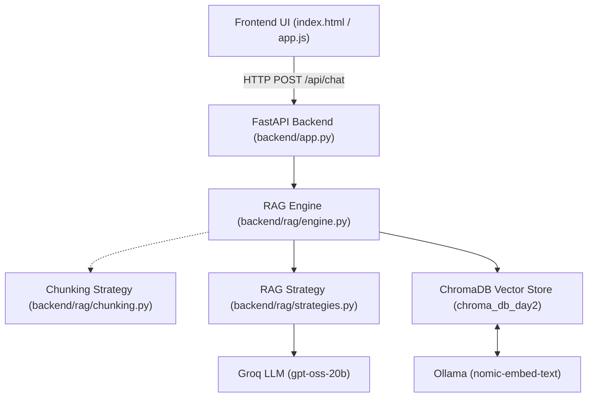

# ORMAS Knowledge Base — Architectural & Developer Guide

## 1. Overview & Architecture

ORMAS Knowledge Base is built with strict **separation of concerns**:
- **Frontend**: Lightweight single-page application (`frontend/index.html`, `style.css`, `app.js`). Zero framework lock-in, customizable design tokens, responsive glassmorphic UI.
- **Backend API**: High-performance FastAPI REST API (`backend/app.py`) with full CORS support.
- **Pluggable Engine**: Strategy patterns for both **Chunking** and **RAG Retrieval** under `backend/rag/`.



---

## 2. Project Directory Structure

```
C:\Users\Sangram Mishra\Desktop\ADK\MODULAR RAG\
├── backend/
│   ├── __init__.py
│   ├── config.py                 # Paths, models, keys, host/port
│   ├── app.py                    # FastAPI endpoints & CORS
│   └── rag/
│       ├── __init__.py
│       ├── chunking.py           # Pluggable Chunking Strategies
│       ├── strategies.py         # Pluggable RAG Retrieval Strategies
│       └── engine.py             # ChromaDB & LLM Execution Engine
├── frontend/
│   ├── index.html                # Modern Chat UI with Strategy Selection
│   ├── style.css                 # Dark Glassmorphism Design System
│   └── app.js                    # API Client & Citation Cards
├── run_server.py                 # One-click launcher
└── ORMAS_KNOWLEDGE_BASE_GUIDE.md # This guide
```

---

## 3. How to Change or Add Chunking Strategies

All chunking logic lives in `backend/rag/chunking.py`.

### Pre-built Strategies:
1. `recursive`: Standard hierarchical splitting (`chunk_size=500`, `chunk_overlap=50`).
2. `sentence`: Groups complete sentences together (`chunk_size=600`, `chunk_overlap=80`).
3. `paragraph`: Splits on paragraph boundaries (`chunk_size=800`, `chunk_overlap=100`).
4. `semantic_window`: Sliding window with heavy overlap (`chunk_size=400`, `chunk_overlap=160`).

### Adding a New Chunking Strategy:
Create a subclass of `BaseChunker` and register it:

```python
# In backend/rag/chunking.py:

class CustomTokenChunker(BaseChunker):
    def __init__(self, chunk_size: int = 512, chunk_overlap: int = 64, **kwargs):
        super().__init__(**kwargs)
        self.chunk_size = chunk_size
        self.chunk_overlap = chunk_overlap

    def split(self, documents: List[Document]) -> List[Document]:
        # Custom splitting logic
        ...
        return chunks

    @property
    def description(self) -> str:
        return f"Token-based chunker (size={self.chunk_size})"

# Register it in the dictionary:
CHUNKING_STRATEGIES["custom_token"] = CustomTokenChunker
```

---

## 4. How to Change or Add RAG Strategies

All RAG prompting and retrieval logic lives in `backend/rag/strategies.py`.

### Pre-built Strategies:
1. `standard`: Balanced semantic retrieval with factual grounding.
2. `context_rich`: Deep context retrieval with detailed section provenance.
3. `concise`: High-impact bullet points for quick executive review.
4. `comparative`: Formats project status and statistics into structured Markdown tables.

### Adding a New RAG Strategy:
Create a subclass of `BaseRAGStrategy` and register it:

```python
# In backend/rag/strategies.py:

class TechnicalDeepDiveStrategy(BaseRAGStrategy):
    def format_context(self, docs: List[Document]) -> str:
        return "\n\n".join(f"[Source: {d.metadata.get('filename')}]\n{d.page_content}" for d in docs)

    def get_prompt(self) -> ChatPromptTemplate:
        return ChatPromptTemplate.from_template("""You are a Technical AI Engineer.
Deep-dive into the architectural details below.
Context: {context}
Question: {question}""")

    def extract_citations(self, docs: List[Document]) -> List[Dict[str, Any]]:
        return [{"filename": d.metadata.get("filename"), "page": d.metadata.get("page")} for d in docs]

    @property
    def description(self) -> str:
        return "Deep-dive technical explanations for engineers."

# Register it:
RAG_STRATEGIES["technical_deepdive"] = TechnicalDeepDiveStrategy
```
The new strategy will **automatically appear in the frontend dropdown** and in `/api/strategies`!

---

## 5. API Reference

| Endpoint | Method | Description |
|---|---|---|
| `/api/chat` | `POST` | Ask a question: `{"query": "...", "rag_strategy": "standard", "top_k": 4}` |
| `/api/documents` | `GET` | List all ingested files, chunk counts, and total vectors |
| `/api/strategies` | `GET` | List all registered RAG and Chunking strategies |
| `/api/reindex` | `POST` | Incrementally sync new files: `{"chunking_strategy": "recursive"}` |
| `/api/health` | `GET` | Health check and system configuration |

---

## 6. How to Run

### Method 1: All-in-One Launcher
```powershell
& "C:\Users\Sangram Mishra\Desktop\ADK\.venv\Scripts\python.exe" run_server.py
```
This starts the backend at `http://127.0.0.1:8000` and automatically opens the UI in your browser.

### Method 2: Decoupled (Separate Frontend & Backend)
1. **Start Backend**:
   ```powershell
   & "C:\Users\Sangram Mishra\Desktop\ADK\.venv\Scripts\python.exe" -m uvicorn backend.app:app --host 127.0.0.1 --port 8000 --reload
   ```
2. **Open Frontend**:
   Double click `frontend/index.html` or open it with any web server (VS Code Live Server, python http.server, etc.).
